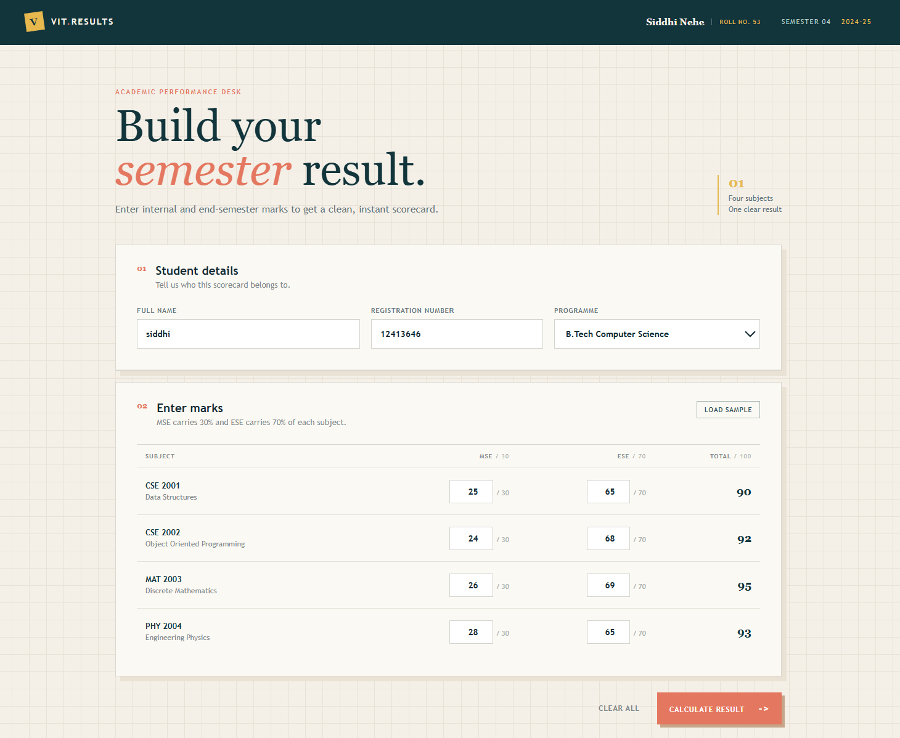
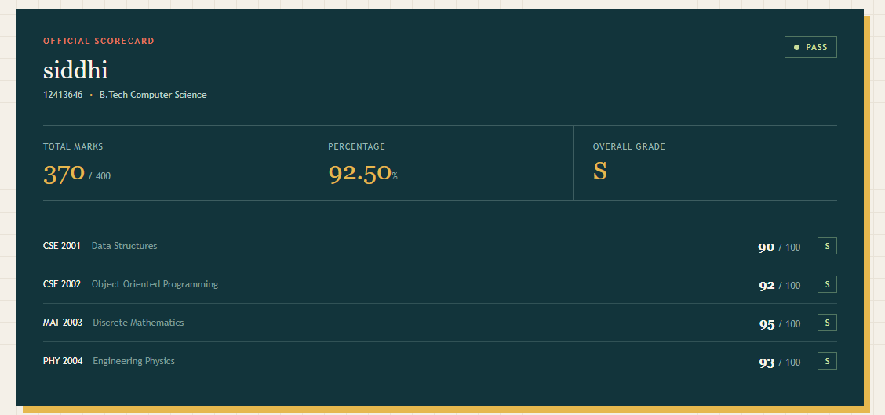

# VIT Semester Result

A React app for entering a student's semester marks and generating an instant scorecard. Add the student's details and marks for four subjects to see totals, percentage, grades, and a pass or review status.

## Screenshots

### Enter student details and marks



### Generated scorecard



## Features

- Enter student name, registration number, and programme.
- Enter MSE and ESE marks for Data Structures, Object Oriented Programming, Discrete Mathematics, and Engineering Physics.
- Load sample student details and marks, or clear the form to start over.
- View a scorecard with per-subject totals and grades.
- Validate required details and mark ranges before calculating.

## Grading

Each subject is scored out of 100: MSE is out of 30 and ESE is out of 70. The overall percentage is the total across all four subjects divided by four. A student passes when every subject total is at least 40.

| Mark | Grade |
| ---: | :--- |
| 90–100 | S |
| 80–89 | A |
| 70–79 | B |
| 60–69 | C |
| 50–59 | D |
| 40–49 | E |
| 0–39 | F |

## Getting started

### Requirements

- Node.js
- npm

### Install and run

```bash
npm install
npm run dev
```

Open the local URL printed by Vite in your browser.

## Available scripts

| Command | Description |
| --- | --- |
| `npm run dev` | Start the Vite development server. |
| `npm run build` | Create a production build in `dist/`. |
| `npm run preview` | Preview the production build locally. |
| `npm run lint` | Run Oxlint. |

## Project structure

```text
src/
  App.jsx       Main form, validation, calculations, and scorecard
  App.css       App and scorecard styles
  index.css     Global styles
  main.jsx      React entry point
public/         Static public assets
```

## Built with

- React
- Vite
- Oxlint
